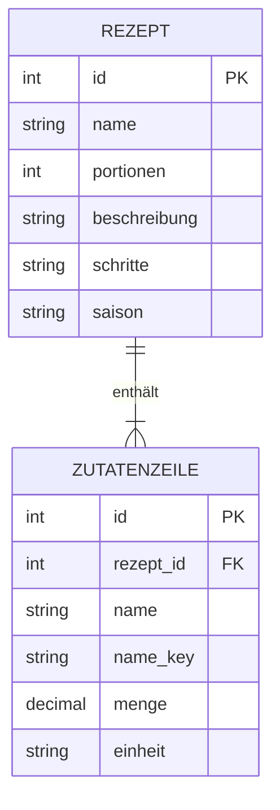

KI-Nutzung: Claude Sonnet 5.5 für schönere Visualisierung

# Datenmodell: WG Cook

Dieses Dokument beschreibt das Datenmodell, das wir in Lab 4 umgesetzt haben. Grundlage sind die Anforderungen in `docs/spec/requirements.md` (insbesondere FR-01 und FR-02) und unser Pitch in `docs/app.md`. Der Code liegt in `backend/app/models.py`.

## 1 Entitäten

| Entität | Rolle | Tabelle | Beschreibung |
|---|---|---|---|
| **Rezept** | Primärentität | `rezepte` | Ein Rezept mit Name, Portionszahl, optionaler Beschreibung und Zubereitungsschritten und einer Saison-Zuordnung. |
| **Zutatenzeile** | Kind-Entität | `zutatenzeile` | Eine Zutat eines Rezepts mit Menge und Einheit. |

**Bewusst keine Entität:** Der **Kalender-Dienst** ist eine externe Abhängigkeit und kein Teil unserer Daten. Er liefert das Datum, aus dem das System die Saison ableitet. Die Saison **eines Rezepts** ist dagegen ein einfaches Feld (`saison`). Wir speichern keine Anfragen an den Dienst und kein Ergebnis als eigene Entität, weil dafür kein fachlicher Bedarf besteht (die Zwischenspeicherung aus FR-12 liegt im Arbeitsspeicher des Dienstes, nicht in der Datenbank).

## 2 Beziehung und Kardinalität

Ein Rezept hat **eine bis viele** Zutaten (1 zu n). Jede Zutat gehört zu **genau einem** Rezept. Beim Löschen eines Rezepts werden seine Zutaten mitgelöscht (Cascade). Die Regel "mindestens eine Zutat je Rezept" (FR-01, FR-05) prüft die Anwendung in der Geschäftslogik (`Rezept.erstelle`, `Rezept.remove_zutat`, `Rezept.validiere`), nicht die Datenbank.

## 3 ER-Diagramm (+ Ausblick)

## 4 Persistenz-Mapping

- **Relationale Persistenz** mit **PostgreSQL** (Entscheidung aus Lab 1, `docs/spec/tech-stack.md`), angesprochen über **SQLAlchemy 2** (objekt-relationales Mapping).
- Aufzählungen (`saison`, `einheit`) werden als **Text** gespeichert (nicht als native Datenbank-Aufzählung), damit sie sich leicht ändern lassen.
- Die **Menge** wird als `Numeric(12, 3)` gespeichert (exakte Dezimalzahl statt Gleitkomma).
- Tabellen entstehen beim Start der Anwendung (`create_all`). Eine Migrationsverwaltung nutzen wir in diesem Stadium nicht.
- Im **Testprofil** (`APP_ENV=test`) verwendet die Anwendung **SQLite im Arbeitsspeicher** statt PostgreSQL.

## 5 Designentscheidungen

1. **Validierung im Modell:** Die Regeln liegen direkt an den Entitäten, damit sie unabhängig von Oberfläche und Datenbank wirken und ohne Datenbank testbar sind.
2. **Kind-Entität heißt Zutatenzeile:** Eine Zutat hat Menge und Einheit nur im Zusammenhang mit einem Rezept. Die Liste aller bekannten Zutatennamen für die Auswahl (FR-07) ergibt sich aus den Zutaten aller Rezepte, wir führen dafür keine eigene Tabelle.
3. **`name_key` als gespeicherte Spalte:** So kann die Datenbank die Eindeutigkeit ohne Groß-/Kleinschreibung prüfen.
4. **Keine Benutzerkonten:** Es gibt keine Entität für Nutzer (FR-15, NFR-07).
