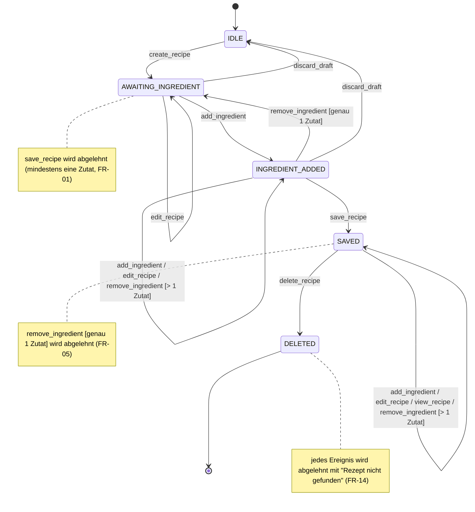

# WG Cook Lab 7

# Exercise 7.1 (20 Points): Black-Box Testing Techniques

| Parameter | Class ID | Class Type | Partition Description | Representative Test Value |
|---|---|---|---|---|
| Zutatenname | EC-1 | valid | lenght from 1 - 100 characters | "tomato" |
| Zutatenname | EC-2 | invalid | no character or empty | "" |
| Zutatenname | EC-3 | invalid | lenght more then 100 characters | 17 * "tomato" |
| Zutatenname | EC-4 | invalid | ingredient may only appear once per recipe | "Tomato", "tomato" |

| Parameter | Class ID | Class Type | Partition Description | Representative Test Value |
|---|---|---|---|---|
| Zutatenanzahl | EC-5 | valid | lenght from 1 - 99999 characters | 3 |
| Zutatenanzahl | EC-6 | invalid | input other then a number | "a" |
| Zutatenanzahl | EC-7 | invalid | greater 99999 | "100000" |
| Zutatenanzahl | EC-8 | invalid | no character or empty | "" |

| Parameter | Class ID | Class Type | Partition Description | Representative Test Value |
|---|---|---|---|---|
| Zutateneinheit | EC-9| valid | dropdown list | "ml" |
| Zutateneinheit | EC-10 | invalid | no selection | "" |

- EC-1: Die Spezifikation behandelt jeden Namen mit 1 bis 100 Zeichen gleich, deshalb vertritt ein beliebiger mittlerer Wert die Klasse. Die Grenzwerte werden in der Grenzwerttabelle einzeln getestet (1 und 100). (FR-02)
- EC-2: Ein leeres Pflichtfeld ist der typische Bedienfehler. Die Länge 0 liegt knapp unter der unteren Grenze 1. (FR-14)
- EC-3: Alle Namen über 100 Zeichen werden gleich abgelehnt, 101 Zeichen ist der Wert knapp oberhalb der oberen Grenze. (FR-02)
- EC-4: Zutatennamen dürfen nicht mehrmals in einem Rezept vorkommen, zwischen Groß- und Kleinschreibung wird nicht unterschieden. Es reicht ein Zutat in Groß- / Kleinschreibung für das Prinzip zu testen. (FR-02)

- EC-5: Die Spezifikation behandelt jede Anzahl von 1 bis 99999 gleich, deshalb vertritt ein beliebiger mittlerer Wert die Klasse.  Die Grenzwerte werden in der Grenzwerttabelle einzeln getestet (1 und 99999). (FR-02)
- EC-6: Alle anderen Inputs außer Zahlen sind invalide und führen nicht zu einem Ergebnis. (FR-14)
- EC-7: Alle Zahlen über 99999 werden gleich abgelehnt, 100000 ist der Wert knapp oberhalb der oberen Grenze. (FR-02)
- EC-8: Ein leeres Pflichtfeld ist der typische Bedienfehler. Die Zahl 0 liegt knapp unter der unteren Grenze 1. (FR-14)

- EC-9: Eine Auswahl zwischen 7 gegebenen Möglichkeiten ist, deshalb ist die Auswahl nicht relevant für Validierung. (FR-02)
- EC-10: Ein leeres Pflichtfeld ist der typische Bedienfehler. Keine Auswahl führt zum Fehler. (FR-14)

| Nr | 1 | 2 | 3 | 4 | 5 | 6 | 7 | 8 |
|---|---|---|---|---|---|---|---|---|
| Zutatenname "tomato" | valid | invalid | valid | invalid | valid | invalid | valid | invalid |
| Menge "3" | valid | valid | invalid | invalid | valid | valid | invalid | invalid |
| Einheit "ml" | valid | valid | valid | valid | invalid | invalid | invalid | invalid |
| Result | valid | invalid | invalid | invalid | invalid | invalid | invalid | invalid |
| FR | 02 | 14 | 14 | 14 | 14 | 14 | 14 | 14 |

# Exercise 7.2 (15 Points): State Transition Testing — Primary Entity Lifecycle

| Nr.   | Current State       | Event                             | Next State          | Output / Action                                                                     |
| ----- | ------------------- | --------------------------------- | ------------------- | ----------------------------------------------------------------------------------- |
| 1     | IDLE                | create_recipe                     | AWAITING_INGREDIENT | Formular mit Rezeptdaten, nichts gespeichert                                        |
| 2     | IDLE                | add_ingredient                    | – (invalid)         | kontrollierter Fehler: kein Rezept in Bearbeitung                                   |
| 3     | IDLE                | remove_ingredient                 | – (invalid)         | kontrollierter Fehler: kein Rezept in Bearbeitung                                   |
| 4     | IDLE                | edit_recipe                       | – (invalid)         | kontrollierter Fehler: kein Rezept in Bearbeitung                                   |
| 5     | IDLE                | save_recipe                       | – (invalid)         | Meldung "Name ist ein Pflichtfeld", nichts gespeichert (FR-14)                      |
| 6     | IDLE                | view_recipe                       | – (invalid)         | "Rezept nicht gefunden" (FR-14)                                                     |
| 7     | IDLE                | discard_draft                     | – (invalid)         | nichts zu verwerfen, keine Änderung                                                 |
| 8     | IDLE                | delete_recipe                     | – (invalid)         | "Rezept nicht gefunden" (FR-14)                                                     |
| 9     | AWAITING_INGREDIENT | create_recipe                     | – (invalid)         | Entwurf ist schon offen, keine Änderung                                             |
| 10    | AWAITING_INGREDIENT | add_ingredient                    | INGREDIENT_ADDED    | Zutat im Entwurf (FR-02)                                                            |
| 11    | AWAITING_INGREDIENT | remove_ingredient                 | – (invalid)         | keine Zutat vorhanden, keine Änderung                                               |
| 12    | AWAITING_INGREDIENT | edit_recipe                       | AWAITING_INGREDIENT | Rezeptdaten im Entwurf geändert                                                     |
| 13    | AWAITING_INGREDIENT | save_recipe                       | – (invalid)         | Meldung "Mindestens eine Zutat ist erforderlich", nichts gespeichert (FR-01, FR-14) |
| 14    | AWAITING_INGREDIENT | view_recipe                       | – (invalid)         | "Rezept nicht gefunden", Entwurf ist nicht gespeichert                              |
| 15    | AWAITING_INGREDIENT | discard_draft                     | IDLE                | Entwurf verworfen, Bestand unverändert                                              |
| 16    | AWAITING_INGREDIENT | delete_recipe                     | – (invalid)         | "Rezept nicht gefunden", Entwurf ist nicht gespeichert                              |
| 17    | INGREDIENT_ADDED    | create_recipe                     | – (invalid)         | Entwurf ist schon offen, keine Änderung                                             |
| 18    | INGREDIENT_ADDED    | add_ingredient                    | INGREDIENT_ADDED    | weitere Zutat im Entwurf (FR-02)                                                    |
| 19    | INGREDIENT_ADDED    | remove_ingredient [> 1 Zutat]     | INGREDIENT_ADDED    | Zutat entfernt                                                                      |
| 20    | INGREDIENT_ADDED    | remove_ingredient [genau 1 Zutat] | AWAITING_INGREDIENT | letzte Zutat entfernt, Entwurf ohne Zutat                                           |
| 21    | INGREDIENT_ADDED    | edit_recipe                       | INGREDIENT_ADDED    | Rezeptdaten im Entwurf geändert                                                     |
| 22    | INGREDIENT_ADDED    | save_recipe                       | SAVED               | Rezept und Zutaten gespeichert, Rezept angezeigt (FR-01)                            |
| 23    | INGREDIENT_ADDED    | view_recipe                       | – (invalid)         | "Rezept nicht gefunden", Entwurf ist nicht gespeichert                              |
| 24    | INGREDIENT_ADDED    | discard_draft                     | IDLE                | Entwurf verworfen, Bestand unverändert                                              |
| 25    | INGREDIENT_ADDED    | delete_recipe                     | – (invalid)         | "Rezept nicht gefunden", Entwurf ist nicht gespeichert                              |
| 26    | SAVED               | create_recipe                     | – (invalid)         | betrifft ein neues Rezept, dieses bleibt unverändert                                |
| 27    | SAVED               | add_ingredient                    | SAVED               | Zutatenzeile gespeichert (FR-05)                                                    |
| 28    | SAVED               | remove_ingredient [> 1 Zutat]     | SAVED               | Zutatenzeile entfernt (FR-05)                                                       |
| 29    | SAVED               | remove_ingredient [genau 1 Zutat] | – (invalid)         | Meldung, dass mindestens eine Zutat bleiben muss, nichts geändert (FR-05)           |
| 30    | SAVED               | edit_recipe                       | SAVED               | Rezeptdaten gespeichert (FR-05)                                                     |
| 31    | SAVED               | save_recipe                       | – (invalid)         | schon gespeichert, keine Änderung                                                   |
| 32    | SAVED               | view_recipe                       | SAVED               | alle Details und Zutaten angezeigt (FR-04)                                          |
| 33    | SAVED               | discard_draft                     | – (invalid)         | kein Entwurf, keine Änderung                                                        |
| 34    | SAVED               | delete_recipe                     | DELETED             | Rezept und alle Zutatenzeilen gelöscht (FR-06)                                      |
| 35–42 | DELETED             | jedes der 8 Ereignisse            | – (invalid)         | "Rezept nicht gefunden", nichts geändert (FR-14, UC-02 2a)                          |

KI Nuztung: Claude Opus 5.5 für Tablle ausformulieren und prüfen dass nichts vergessen wurde ausm diagramm

TS-1 (Start IDLE, deckt 1, 12, 10, 24)

| Step | Event | Erwarteter Zustand | Erwartete Ausgabe | Anforderung |
|---|---|---|---|---|
| 1 | create_recipe ("Tomatensalat", 4 Portionen) | AWAITING_INGREDIENT | Formular mit Rezeptdaten | FR-01 |
| 2 | edit_recipe (Portionen 4 → 6) | AWAITING_INGREDIENT | Portionen 6 | FR-05 | 
| 3 | add_ingredient (Tomaten 3 Stück) | INGREDIENT_ADDED | 1 Zutat | FR-02 |
| 4 | discard_draft | IDLE | Bestand unverändert | UC-03 |

TS-2 (Start IDLE, deckt 1, 10, 18, 19, 20, 15)

| Step | Event | Erwarteter Zustand | Erwartete Ausgabe | Anforderung |
|---|---|---|---|---|
| 1 | create_recipe | AWAITING_INGREDIENT | Formular | FR-01 |
| 2 | add_ingredient (Tomaten) | INGREDIENT_ADDED | 1 Zutat | FR-02, EC-01 |
| 3 | add_ingredient (Zwiebel) | INGREDIENT_ADDED | 2 Zutaten | FR-02 | |
| 4 | remove_ingredient (Zwiebel), vorher 2 | INGREDIENT_ADDED | 1 Zutat | FR-05 |
| 5 | remove_ingredient (Tomaten), vorher 1 | AWAITING_INGREDIENT | keine Zutat | FR-05 |
| 6 | discard_draft | IDLE | Bestand unverändert | UC-03 |

TS-3 (Start IDLE, deckt 1, 10, 21, 22, 32, 27, 28, 30, 34)

| Step | Event | Erwarteter Zustand | Erwartete Ausgabe | Anforderung |
|---|---|---|---|---|
| 1 | create_recipe | AWAITING_INGREDIENT | Formular | FR-01 |
| 2 | add_ingredient (Tomaten) | INGREDIENT_ADDED | 1 Zutat | FR-02 |
| 3 | edit_recipe (Saison → Sommer) | INGREDIENT_ADDED | Saison Sommer | FR-01 |
| 4 | save_recipe | SAVED | Rezept gespeichert und angezeigt | FR-01 |
| 5 | view_recipe | SAVED | Details und 1 Zutat | FR-04 |
| 6 | add_ingredient (Zwiebel) | SAVED | 2 Zutaten gespeichert | FR-05 |
| 7 | remove_ingredient (Zwiebel), vorher 2 | SAVED | 1 Zutat | FR-05 |
| 8 | edit_recipe (Portionen → 2) | SAVED | Portionen 2 | FR-05 |
| 9 | delete_recipe | DELETED | Rezept und Zutaten gelöscht | FR-06 |

Sequenzen mit ungültigem Übergang (Assert: Zustand unverändert und spezifizierter Fehler)

| TC | Startzustand | Ereignis | Erwarteter Zustand | Erwartete Ausgabe | Anforderung |
|---|---|---|---|---|---|
| TS-4 | AWAITING_INGREDIENT | save_recipe | AWAITING_INGREDIENT | "Mindestens eine Zutat ist erforderlich", nichts gespeichert | FR-01, FR-14 |
| TS-5 | SAVED (1 Zutat) | remove_ingredient | SAVED | Meldung "mindestens eine Zutat", nichts geändert | FR-05 |
| TS-6 | DELETED | view_recipe | DELETED | "Rezept nicht gefunden" | FR-14, UC-02 2a |
| TS-7 | INGREDIENT_ADDED (Mehl) | add_ingredient ("mehl") | INGREDIENT_ADDED | Meldung zur doppelten Zutat | FR-02, FR-14 |
